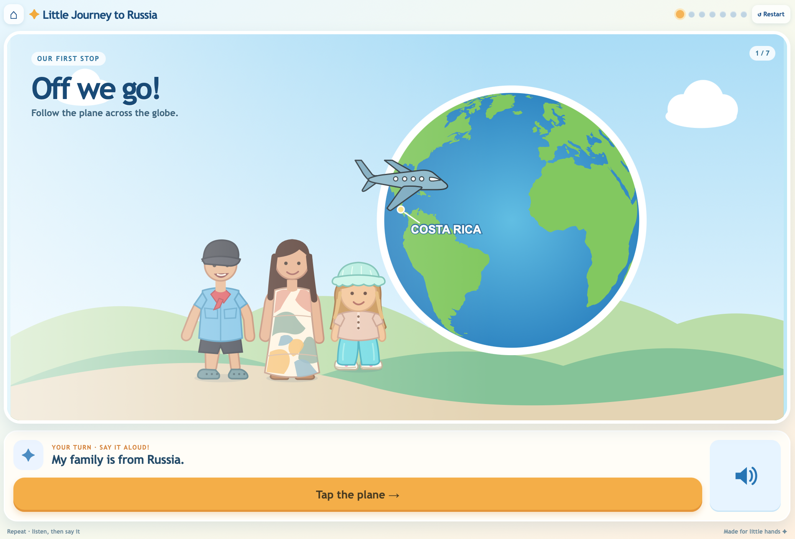

# Little Journey to Russia

A small touch-first interactive story to practice a kindergarten presentation. It uses plain HTML, CSS, JavaScript, and original SVG illustrations. There are no network services or build dependencies after the static files load.

## Preview



## Play

Choose **Listen**, **Repeat**, or **Tell**, then tap **Start journey**. Tap the large action button or the illustrated object in each stop. The speaker button replays the current sentence. In Tell mode, the sentence stays hidden until the speaker hint is tapped. The recap shows five pictures without automatically speaking or showing the answers.

An adult can use **Home** or **Restart** at any time. The selected mode and current stop are remembered in local storage. Reopening the browser restores the beginning of that stop without playing audio. When the browser wakes, the current scene is shown in a settled state and audio remains stopped until the next tap.

## Edit the story

The seven sentences and MP3 paths are in [`src/story.js`](src/story.js). Put your own recordings under [`assets/audio/`](assets/audio/README.md) using those filenames. Missing recordings are harmless; the written sentence acts as the hint. You can replace recordings without rebuilding a running Compose installation because that directory is mounted read-only.

## Run locally

For a quick browser preview from this directory, use any static file server, for example:

```bash
python3 -m http.server 8081
```

Open `http://localhost:8081/` in Chromium. The fridge is the final compatibility target; test a full Cover screen cycle there, plus a network reconnect and browser reopen.

## Staging with Docker Compose

The shared `tailscale-ingress` Docker network and gateway must already exist. Use separate installation directories for staging and production, with distinct Compose project names, ingress aliases, and base paths. Do not print values from `.env` files when checking configuration.

```bash
cp .env.example .env
docker build -t little-journey-to-russia:local .
docker compose config -q
docker compose up -d
```

The single `little-journey-to-russia:local` tag is reused for development and staging. Change MP3 files under `assets/audio/` without rebuilding the image. The staging URL path from `.env.example` is `/apps/little-journey-to-russia-staging/` on the configured gateway host.

Production uses a published immutable image and its own directory, `.env`, and recordings. The GitHub workflow validates the Compose service on pull requests and publishes versioned images from pushes and version tags. For example, use a published `ghcr.io/<owner>/little-journey-to-russia:1.0.0` image with `STORY_PULL_POLICY=always`, a production Compose project name and ingress alias, and `STORY_BASE_PATH=/apps/little-journey-to-russia`. From that directory, run `docker compose config -q`, `docker compose pull`, then `docker compose up -d`.

No page installation, service worker, microphone, or external asset host is required.
